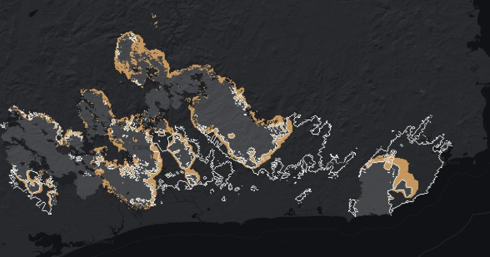

# Vigil

Predicting where a bushfire in Victoria will burn tomorrow, from where it's burning today.

**Live site: https://vigil-c5o.pages.dev**

**Dataset:** the daily fire labels are published on Zenodo, [doi:10.5281/zenodo.24049740](https://doi.org/10.5281/zenodo.24049740) (CC BY 4.0; see [release/](release/)).



## Result

On the 2019–20 Black Summer fires, which no model saw while it was being built, the main model caught about 4 in 10 of the places that burnt the next day. A simple rule that pushes the fire downwind caught about 2 in 10. Both were right about a third of the time.

In numbers: F1 0.362 (95% range over fires 0.330 to 0.428) against 0.265 for the simple rule, a gap of 0.097 (0.072 to 0.134). The test season was run once, with a protocol written in advance. Long-range spread (more than 6 km from the fire) and grass fires are not predicted well by any model. Full write-up: [Findings](https://vigil-c5o.pages.dev/findings).

The main model is a U-Net given a physics model's prediction (CSIRO spread equations) as an input, and no raw weather maps.

I built this with Claude Code. The design and evaluation decisions, with the reasoning behind each, are recorded in [CLAUDE.md](CLAUDE.md).

## Reproduce

### What you need

- **Accounts and keys**
  - A NASA Earthdata login in `~/.netrc` (for MODIS burned area): `machine urs.earthdata.nasa.gov login <user> password <password>`
  - A NASA FIRMS map key in `.env` at the repo root: `FIRMS_MAP_KEY=...` (free, from https://firms.modaps.eosdis.nasa.gov/api/map_key/)
  - Everything else downloads without an account.
- **One manual download:** the ABS state boundary for Victoria (ASGS Edition 3, 2021), saved as `data/raw/abs_boundary/vic_ste_2021.geojson`. It's only used for sanity checks and the Landscape page.
- **Disk:** about 18 GB of raw data and 7 GB of processed data.
- **Hardware:** the results were produced on an Apple Silicon Mac, training on its GPU (PyTorch MPS). CUDA should work but is untested.
- **Python 3.13** and the pinned packages:

```
python3.13 -m venv .venv && source .venv/bin/activate
pip install -r requirements.txt && pip install -e .
```

### Steps, in order

Times are rough, from the original runs. "Not timed" means it ran quickly enough that I didn't record it.

| Step | Commands | Rough time |
|---|---|---|
| 1. Download | `python -m vigil.data.firms`, `vigil.data.mcd64a1`, `vigil.data.barra2`, `vigil.data.silo`, `vigil.data.dem`, `vigil.data.fuel`, `vigil.data.fire_history`, `vigil.data.fire_history_nsw_sa` | BARRA2 about 4 to 5 h; DEECA fire history about 20 min; others not timed |
| 2. Grid the inputs | `python -m vigil.mcd64`, `vigil.static`, `vigil.burn_history`, `vigil.weather`, `vigil.dryness` | Not timed |
| 3. Fire events and labels | `python -m vigil.events prepare`, `vigil.events build --dist 5 --gap 14`, `vigil.labels build` | Not timed |
| 4. Training windows | `python -m vigil.windows`, `vigil.dataset` (normalisation stats) | Not timed |
| 5. Baselines and physics | `python -m vigil.evaluate baselines`, `vigil.physics cv`, `vigil.physics channel` (optional: `vigil.pixel_baselines prepare` then `run`) | Physics CV about 15 min; the physics channel takes about 4 s per fire-day |
| 6. U-Net cross-validation | `python -m vigil.unet cache`, `vigil.unet physics_cache`, `vigil.unet_plan2`, `vigil.unet_tune2`, `vigil.unet_plan2 summary` | About 7.5 h of training for the CV runs, plus about 2.5 h of tuning |
| 7. Test, once | `scripts/test_chain.sh` (physics CV, a dry run, then `python -m vigil.test_eval`) | About 1 h |
| 8. Website data | `python -m vigil.web_export`, `vigil.compare_export`, `vigil.landscape_export`, `vigil.site_figures`, then `cd app && python3 -m http.server 8765` | Not timed |

All commands are `python -m ...`. `test_eval` refuses to run if `docs/results/test_results.csv` exists, so the recorded test result can't be overwritten by accident. To rerun it yourself, move that file aside first.

## Layout

```
src/vigil/data/   download scripts, one per source
src/vigil/        pipeline, baselines, physics model, U-Net, evaluation, site exports
scripts/          the test-run chain
tests/            augmentation test
docs/results/     CV and test results (the numbers on the site come from here)
docs/figures/     figures from development
archive/          the first U-Net plan, superseded but kept for its recorded results
app/              the static website (deployed from the site branch)
data/             raw and processed data (not committed)
```

## Credits

Built on Huot et al. (2022), "Next Day Wildfire Spread"; Parks (2014) for day-of-burning maps; and CSIRO fire spread models (Cheney et al. 1998 and 2012, Cruz et al. 2013 and 2015). Full references with DOIs are on the [Findings](https://vigil-c5o.pages.dev/findings) page.

Data: NASA FIRMS VIIRS and MODIS MCD64A1, Bureau of Meteorology BARRA2, SILO, Copernicus DEM, the CSIRO Bushfire Fuel Classification fuel map, Victorian (DEECA), NSW (NPWS) and South Australian (DEW) fire history, and ABS boundaries. Licences and links are in [DATA_LICENSES.md](DATA_LICENSES.md).

Code is MIT ([LICENSE](LICENSE)). The derived data and the website are non-commercial, because the CSIRO fuel map is CC BY-NC 4.0.

Not for safety decisions. For current fires, see [VicEmergency](https://emergency.vic.gov.au).
